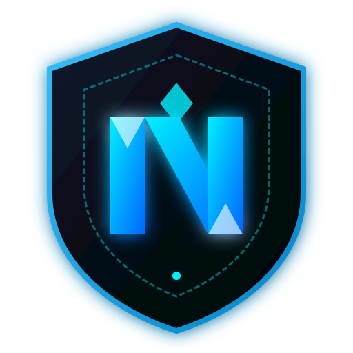

# ⚡ NEXUX Launcher

<div align="center">
  
  <h2>Next-Generation Cyber-Themed Minecraft Launcher</h2>
  <p><strong>Custom-branded fork of Prism Launcher with built-in 1-Click Mod Downloader, Cyber Neon Themes & Automated Windows CI/CD</strong></p>
</div>

---

## 🚀 Features

- 💎 **NEXUX Cyberpunk Aesthetic**: Modern neon cyan, deep space obsidian, and custom glassmorphism styling built directly into Qt and QSS stylesheets.
- 🎨 **5 Switchable Cyber Themes**:
  - ⚡ **NEXUX Cyber Neon**: Signature electric cyan & cyber blue glow (`#00f0ff` / `#00a8ff`)
  - 🌲 **NEXUX Matrix Emerald**: Cyber green matrix terminal (`#00ff88`)
  - 🩸 **NEXUX Crimson Blood**: High-octane combat red & neon crimson (`#ff2a55`)
  - 🔮 **NEXUX Synthwave Violet**: Retro cyberpunk purple & magenta (`#c084fc`)
  - 🌑 **NEXUX Pure Stealth**: Ultra clean matte dark stealth (`#94a3b8`)
- ⚡ **1-Click Mod Downloader**:
  - Integrated directly on the main instance toolbar and right-click context menu.
  - Powered by Modrinth & CurseForge API for instant search and 1-click `.jar` download.
- 🌐 **NEXUX Companion Web Dashboard**:
  - Live interactive theme switcher and live mod search & download directly into any local Minecraft/Prism instance.
- 🛠️ **Automated Windows `.exe` Builds**:
  - GitHub Actions automatically compiles `NEXUXLauncher.exe` and packages `NEXUX-Launcher-Setup.exe` and `NEXUX-Launcher-Portable.zip`.

---

## 📦 How to Build or Download Windows .exe

### Method 1: Automated GitHub Actions Release (Zero local install needed!)
1. Go to your repository: **[github.com/mynameisarnavsharma-ctrl/NEXUX-Launcher](https://github.com/mynameisarnavsharma-ctrl/NEXUX-Launcher)**
2. Click the **Actions** tab.
3. Select **"NEXUX Launcher Windows Build & Release"** on the left.
4. Click **Run workflow** ➔ Select branch `develop` (or `main`) ➔ Click **Run workflow**.
5. Once completed (~5-8 mins), download the ready-to-run **`NEXUX-Launcher-Portable.zip`** or **`NEXUX-Launcher-Setup.exe`** under **Artifacts** or **Releases**!

---

## ⚡ Running the Local NEXUX Companion & 1-Click Mod Manager

To start the local companion dashboard:

```bash
cd nexux-companion
npm start
```

Open your browser at **`http://localhost:4500`**:
- Switch themes with 1 click!
- Search 50,000+ Minecraft mods (Sodium, Iris, JEI, JourneyMap, Lithium, etc.).
- Click **"⚡ 1-Click Install"** to automatically download the mod into your selected instance!
- Click **"🚀 Apply to Prism Launcher"** to immediately install the theme to your local Prism Launcher.

---

## 📜 Credits & License
- Forked from [PrismLauncher](https://github.com/PrismLauncher/PrismLauncher) under GPL-3.0.
- Custom Branding, Themes, and 1-Click Mod Downloader created for **NEXUX** (`nexuxsmp.play.hosting`).
